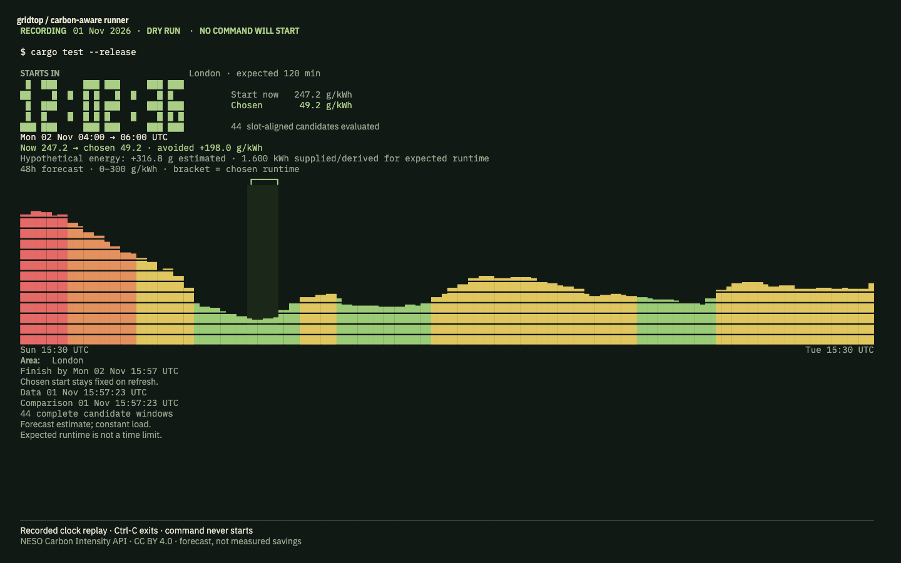

# gridtop

[](https://harryfreeman.dev)

Gridtop waits for the cleanest complete window in Great Britain’s regional electricity forecast, then runs your command with its input, output, signals and exit code intact. Its countdown shows what it chose and how that forecast compares with starting immediately. A fourteen-region terminal map puts the same numbers on the real geography; a local ledger keeps the comparison afterwards. No account, API key, daemon or hosted model.



## Try it

Requires macOS or Linux, Rust **1.94.0 or newer**, a C compiler and a Unicode terminal. Build from this checkout:

```sh
cargo build --release --locked
./target/release/gridtop run --demo --dry-run --watch --for 2h --watts 800 -- cargo test --release
```

This offline preview computes a real plan from the public forecast saved on **1 November 2026**, replays its clock and labels the supplied 800 W as hypothetical. It never starts the command or writes a ledger. **Ctrl-C exits.** The first build downloads Rust dependencies; no local model or model download is needed.

Open the recorded map, inspect a live plan, or schedule a real command:

```sh
./target/release/gridtop --demo
./target/release/gridtop next --region 13 --within 12h --for 2h --json
./target/release/gridtop run --region 13 --within 12h --for 2h --watts 800 -- cargo test --release
./target/release/gridtop runs
```

Live plans need read-only HTTPS access to `api.carbonintensity.org.uk`. The map uses arrow keys for forecast time, **j/k** for region, **t** for theme and **?** for help. A recorded preview remains visibly dated while live data loads. `--live-only` starts without it. Recordings can never release a job. If a live forecast cannot be acquired, execution fails unless you explicitly choose `--now-if-unavailable`; that fallback carries no carbon estimate.

A terminal of **80×24** works; **164×50** gives the map and forecast more room. [Full commands, controls and ledger details](docs/usage.md).

## How it works

The scheduler evaluates every feasible **API half-hour boundary** at or after now. It integrates the piecewise-constant forecast across the entire requested runtime, including partial end slots, and selects the lowest time-weighted average. Ties choose the earliest start. CLI, TUI and cleanest-wait share the same search.

```text
average(t) = sum(forecast_i × overlapping_seconds_i) / expected_runtime_seconds
avoided intensity = average(start immediately) − average(chosen window)
estimated grams = avoided intensity × supplied or derived kWh
```

This is temporal shifting, also used by the [Green Software Foundation Carbon Aware SDK](https://github.com/Green-Software-Foundation/carbon-aware-sdk). The implementation is an exact search over the [NESO Carbon Intensity API](https://api.carbonintensity.org.uk/), rather than a learned predictor. Energy and intensity remain separate inputs, as in the operational-emissions term of the [Software Carbon Intensity methodology](https://sci.greensoftware.foundation/); gridtop does not claim a complete SCI score.

Once chosen, the start stays fixed while forecasts refresh. A final gate rechecks freshness, region, coverage, lateness and deadline before launch. The child receives its original argument array without shell interpolation. Terminal ownership and signals pass through, including to grandchildren; terminal state is restored afterwards.

The map is rasterised at build time from official NESO licence-area polygons, including holes and islands. An explicit join connects boundary IDs to forecast IDs. Colours represent forecast intensity bands, not weather or power flows. [Architecture](docs/architecture.md), [public recordings](tests/fixtures/SOURCE.md) and [boundary provenance](data/SOURCES.md).

## What it measures / proves

- **300 scheduling cases** agree with an independent minute-resolution oracle, including mid-slot planning, fractional edges and earliest-start ties.
- **73 tests** cover parsers, deadlines and DST offsets, cancellation, signal forwarding, ledger failures, map coordinates, rendering and self-contained typography.
- Native pseudo-terminal checks exercise quit, Ctrl-C, SIGTERM, resizing, panic cleanup, child input and terminal restoration. These are separate from the HTML screenshot checks.
- Browser validation covers the same **81 exported frames** in Chromium, WebKit and Firefox, across wide, 80×24 and phone layouts and all three themes. It checks loaded local fonts, overflow, errors, external requests and geometry during a forced font swap. Chromium exposes CLS; other engines report geometry without inventing an unavailable CLS number.

Frame-time measurements, exact check commands and their scope are recorded in [validation](docs/validation.md). A browser screenshot proves the export renders correctly; it is not evidence that a native terminal runs inside a browser.

## Limits

Forecast average consumption intensity is not marginal generation or causally measured avoided emissions. `--kwh` and `--watts` are user assumptions; no energy input means no grams. Signed differences remain signed, including when delay is forecast to be worse. The ledger records runtime and exit status separately from the forecast comparison.

`--for` is an expected runtime, not a timeout. The process must remain running while waiting; there is no durable queue, crash recovery or unattended restart. A missed or stale window refuses launch. Full shell job control with Ctrl-Z, `fg` and `bg` is unsupported. [Known upstream dependency warnings](SECURITY.md) remain visible in the audit; the URL/IDNA advisory is fixed.

The recorded forecast is dated **1 November 2026** and is never shifted to look current. Narrow maps omit sub-pixel geography; markers and the regional list remain available. Typography in native terminals is controlled by the emulator; select IBM Plex Mono there. HTML exports embed Plex Sans, Mono and Sans Condensed, with system fallback for drawing glyphs absent from the latin fonts.

## How it was built

Designed, specified and reviewed by Harry Freeman; built with AI coding agents.

- **BRIEF:** Harry set the original bar: an immediate, useful demonstration, careful finish, honest data and real tests.
- **V2:** He chose a terminal view of Great Britain’s fourteen regions using real boundaries, then sent the faint forecast plots back for solid, legible bars in every theme and at 80×24.
- **V3:** He directed the move from a monitor to a carbon-aware command runner, with explicit failure behaviour, signal forwarding and a ledger that estimates grams only from supplied energy.
- **Review:** Harry ran `now`, `best` and `wait`, then required one shared half-hour alignment rule. He later chose IBM Plex across the collection.

## Licence

Code: [MIT](LICENSE), **Copyright (c) 2026 Harry Freeman**.

Electricity data: National Grid ESO / NESO Carbon Intensity API, **[CC BY 4.0](https://creativecommons.org/licenses/by/4.0/)**. Replays and derived charts do not imply provider endorsement.

Boundaries: **Supported by National Energy SO Open Data**, under the NESO Open Data Licence, adapted from OGL v3. [Source and complete licence](data/SOURCES.md).

Typography: IBM Plex latin WOFF2, @fontsource 5.3.0, **SIL OFL 1.1**. [Notices and pinned sources](FONT-LICENCES.md). [Rust dependency licences](DEPENDENCIES.md).

Harry Freeman’s badge identifies his work and is covered by its [mark licence note](docs/brand/LICENSE.md).
